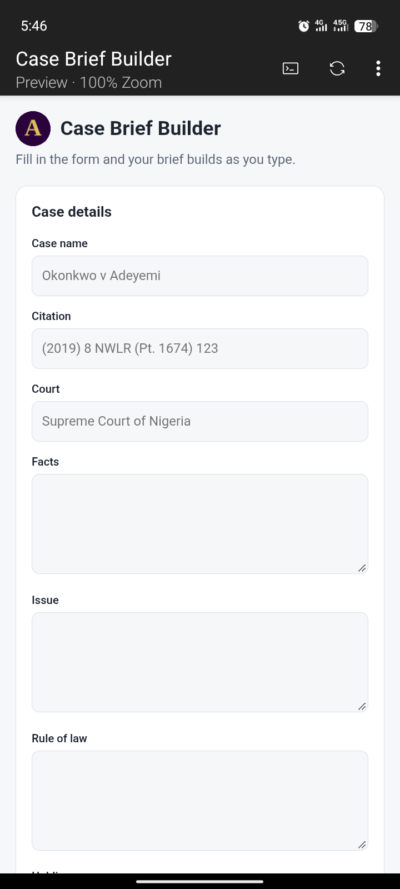

# Case Brief Builder ⚖️

A simple web app for law students to quickly create, structure, and organize legal case briefs using the IRAC/FIRAC method.

**Live Demo:** https://case-brief-builder.vercel.app/

## Preview



### Features
- Create case briefs in seconds
- Structured template: Facts, Issue, Rule, Application, Conclusion (FIRAC)
- Auto-save drafts
- Edit, delete, and duplicate briefs
- Search & filter briefs by course or case name
- Export brief as PDF / Copy to clipboard
- Clean, minimal UI for focused reading
- Fully responsive

### Tech Stack
- Next.js / React (Vite)
- Tailwind CSS
- Vercel for deployment
- LocalStorage for draft saving

### Installation

1. Clone the repository:
```bash
git clone https://github.com/your-username/case-brief-builder.git
cd case-brief-builder
npm install
npm run dev


src/
├── components/
│   ├── BriefForm.jsx
│   ├── BriefCard.jsx
│   └── Header.jsx
├── pages/
│   └── index.jsx
└── styles/

## Author
Adeola Ejikunle — [GitHub](https://github.com/DevAdeh)